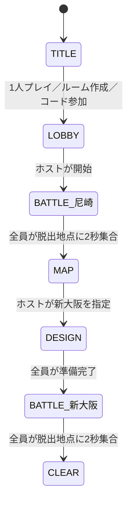

# Road to Kanagawa — ゲーム仕様書

更新日：2026年10月23日（日本時間）／現行仕様 1.1

本書はユーザーの企画書と、その後の開発会話・実装内容を統合した現行仕様である。原案は [ORIGINAL_PROPOSAL.md](ORIGINAL_PROPOSAL.md) に保存する。原案と後続のユーザー指示が異なる場合は、後続の指示を優先する。本書では実装済み・将来構想・未決定を区別する。今後の会話で仕様が追加・変更された際も、実装と同じ変更に本書と [CHANGELOG.md](CHANGELOG.md) の更新を含める。

## 1. 作品全体の目標（企画）

ゾンビによって崩壊した日本を、関西から横浜まで1台の車で東へ進む、PCブラウザ向け1〜4人協力サバイバルロードゲーム。戦闘と探索で食料・燃料・素材を回収し、武器や車の強化、ノードとエッジからなるルートの選択を繰り返す。ゾンビの全滅は必須ではなく、物資を探す危険と撤退する判断が中心となる。

将来の基本ループは MAP（多数決でルート選択）→ PREPARATION（時間制限のない準備・クラフト）→ BATTLE（戦闘・探索）→ RESULT（結果確認）。時間をかけただけで資源は減らず、移動に応じて消費する。戦闘終了時の自動報酬は付与しない。全滅、食料切れ、車の修復不能などの敗北条件と、燃料切れからの復旧手段を今後整備する。最終的には横浜のイベントを突破してクリアとなる。

## 2. 現在のプレイ範囲（実装済み）

現在は尼崎と新大阪の2ノード・1エッジによるプロトタイプ。敵・戦闘・死亡・車・クラフトは未実装。

戦闘・脱出、移動先の指定、設計の3状態を基本とする。尼崎から始め、新大阪の脱出で「クリア！」と表示する。設計は全員の準備完了を待つ画面で、最後の1人が押すまでは準備完了を取り消せる。

## 3. 表示と入力

- JavaScript、Phaser 3、Vite を使用する。
- タイトル、入力欄、ボタン、ロビー、ルーム情報、通知、ルート、設計、HUD、クリア表示を含め、ユーザーに見える要素はすべてゲームウィンドウ内のCanvasに描画する。
- 日本語IME・貼り付けのために非表示のネイティブ入力を使う。外側に表示するHTMLフォームやHTMLボタンは設けない。
- PCのキーボードとマウスが対象。スマートフォン操作は未対応。
- 「タイトルへ」ボタンは表示しない。協力プレイではルームを離れるための「退出」を残す。1人プレイを最初からやり直すにはページを再読み込みする。
- ゲーム用PNGの完成までは図形描画による仮素材を使う。将来のPNGにはファイル名・サイズ・視点・アニメーション枚数・透過・表示サイズ・原点を事前定義する。

| 操作 | 入力 |
| --- | --- |
| 移動 | WASD / 矢印キー |
| 走る | Shiftを押しながら移動 |
| チェスト開封 | 範囲内でEを0.5秒長押し |
| 行き先の情報 | ノードにマウスオーバー |
| 行き先を選ぶ | 新大阪ノードをクリック / Enter（ホストのみ） |

## 4. タイトル・ルーム・ロビー

タイトルではプレイヤー名、1人プレイ、協力ルーム作成、ルームコードまたは招待URLでの参加を選べる。招待URLのクエリからコードを自動入力する。名前は最大20文字相当の入力長。コードはランダムな12文字の英数字（現在は16進文字）。ロビーは最大4人で、名前、ホスト、空き人数、開始操作をゲーム内表示する。招待URLをコピーできる。

「ルーム作成」は共有Cloudflareサーバー上の部屋を用意する意味であり、参加者のPCでサーバープロセスを立ち上げる操作ではない。ホストは1人でも開始可能。

1人プレイではルーム作成APIとWebSocketの両方を使用しない。ロジックはブラウザ内で動かす。協力プレイでは1ルーム1 Durable Objectが状態を管理し、ホストのみが開始・行き先選択を実行できる。

開始済みルームへの途中参加、再接続、保存と途中再開は未対応。切断者は集合・準備判定から除き、ホスト切断時は次の参加者へ移譲する。全員退出時に状態を初期化する。実行インスタンスの再起動では進行を失う。コードは招待用であり、個別ユーザー認証ではない。

## 5. 戦闘マップ・移動

- 平原と道路からなる64×64ピクセルのタイルグリッド。
- マップは16列×10行、1024×640ピクセル。表示するタイルと移動範囲を一致させ、以前の832×640タイルに対する800×600移動範囲のずれを解消する。
- Canvasは1024×848ピクセル。上部128ピクセルは操作案内とHUD、中央はマップ全域、下部は共有物資と通知。
- プレイヤー半径相当の16ピクセル分を考慮してマップ端を制限する。斜め移動を正規化する。
- 通常移動は220px/秒。1人プレイは描画フレームごとの経過時間でシミュレーションし、20Hzの座標更新による段付きの動きを避ける。長いフレームの進行は最大50msに制限する。
- 協力プレイはサーバー20Hz。受信位置をクライアントで補間する。将来のクライアント予測・巻き戻し補正は未実装。

### 走行とスタミナ

- 初期スタミナ100%。Shift＋移動で通常の1.4倍、308px/秒。
- 1秒あたり25ポイント消費し、満タンから最大4秒走行できる。
- 走行していない間（歩行・停止を含む）は1秒あたり100/6ポイント回復し、0%から100%まで6秒。
- 立ち止まったままShiftを押しても消費しない。
- 枯渇すると走行を停止する。Shiftを離すまで自動再走行せず、Shiftを離して押し直すと残量に応じて走れる。
- ステージ開始時に全回復。スタミナ量と走行状態をゲーム内HUDに表示する。協力プレイではサーバーが値を確定する。

## 6. 脱出

全参加者が脱出地点内に連続して2秒間とどまると脱出成立。敵の全滅や全チェスト開封は不要。現在は死亡が未実装のため全参加者を判定する。

1人以上が入ると脱出ゾーンが緑のオーラをまとって脈動する。ラベルは常に「脱出地点」のみ。小さなプログレスバーをゲーム画面内、オーラのすぐ上に表示する。全員が揃うまで進まず、誰かが外へ出ると進捗をリセットする。バーが満タンになると尼崎ではMAP、新大阪ではCLEARに遷移する。以前の到達直後0.9秒の演出待ちは廃止済み。

## 7. チェストと物資（今回追加）

### 配置と内容

各ステージ開始時に2〜4個をランダム配置する。配置は64ピクセルグリッドの異なるセル中心で、出発地点や脱出地点と重ならない内側の範囲とする。ステージごとに位置・個数・内容を生成し直す。

現在の最小実装では、各チェストに以下から等確率で1種類入る。これは内容数と確率の初期設定であり、将来調整可能。

| アイテム | 1チェストあたりの数量 |
| --- | --- |
| 食料 | 2〜4（各数量等確率） |
| 燃料 | 2〜4（各数量等確率） |
| 小銃 | 1 |
| ナイフ | 1 |
| 帽子 | 1 |

小銃・ナイフの攻撃機能、帽子の装備効果は未実装で、現在は所持数のみ管理する。素材は原案の将来項目であり、今回の抽選候補には含めない。

### 開封

- 未開封チェストの中心から52px以内に近づき、Eを0.5秒長押しする。
- 最寄りの未開封チェストが対象。候補があるとゲーム内に案内を表示する。
- 開封中はチェストの上に小さなプログレスバーを表示する。
- Eを離す、範囲外へ出る、開封者が切断する場合は進捗をリセットする。別の人が引き継ぐ場合も0から。
- 1チェストは1回のみ開封できる。同時操作でもサーバーが1人を開封者として扱い、二重取得を防止する。
- 完了時に自動回収し、チーム共有の所持数へ加算する。蓋が開いた表示になり、取得した種類と数量をチェスト上に表示する。
- 未開封の内容は協力プレイのクライアントへ配信しない。開封済みの内容と共有所持数は全員に同期する。
- 共有物資HUDはゲーム内に表示し、次のステージでも所持数を維持する。容量制限・個人インベントリ・装備変更は未実装。
- ステージ脱出による追加物資は付与しない。

## 8. 移動先マップ

ゲームウィンドウ内に「尼崎 ○―○ 新大阪」を表示する。丸がノード、線がエッジ。地名は各ノードの上に表示する。現在地は緑、選べる次ノードは金色。ホストのみ新大阪の丸をクリックまたはEnterで選択可能。

各ノードのマウスオーバーで、ゲーム内パネルに到達までの必要物資とノードの特徴を表示する。外側にHTMLツールチップは作らない。

- 尼崎：現在地。移動不要のため必要物資なし。平原・道路の出発地点、脱出済み。
- 新大阪：次の目的地・現在の最終ノード。平原・道路で、脱出するとクリア。
- 新大阪までの食料・燃料消費量は未決定。現在は「未設定（消費なし）」と表示し、実際に消費しない。
- 原案の多数決・同票時の決選投票は将来機能。現在の2ノード版はホスト指定。

## 9. 技術と通信

JavaScript / Phaser 3 / Vite / Cloudflare Workers / Durable Objects / WebSocket / GitHub。

公開はWorkers Static Assetsでクライアントも同一オリジンから配信する。原案のCloudflare Pages分離構成は未採用。プレイヤーは公開URLをブラウザで開くだけで遊べる。

協力プレイでは入力のみを送り、座標・速度・スタミナ・開封・取得・フェーズ遷移をサーバーで検証・確定する。入力停止300msで操作を解除。入力は真偽値を検証し、サイズと頻度に上限を設ける。クライアントが送った座標・物資数量は採用しない。

| 方向 | メッセージ | 主な内容 |
| --- | --- | --- |
| client → server | input | left/right/up/down/sprint/interact |
| client → server | start | ホストの開始操作 |
| client → server | select_destination | 新大阪の選択 |
| client → server | ready | 準備完了の真偽値 |
| server → client | welcome | 接続者ID |
| server → client | state | フェーズ、ノード、参加者、チェスト、共有物資、脱出進捗 |

乱数は協力プレイではサーバー側、1人プレイではブラウザ内で生成する。実装箇所は `shared/game.js`（共通ロジック）、`server/src/index.js`（ルーム）、`client/src/main.js`（Canvas UI）。

## 10. 未実装・未決定と今後の順序

未実装：ゾンビAI・攻撃・HP・死亡・蘇生、素材・クラフト・車、共有資源の消費、容量制限、個人物資、投票、RESULT、都市イベント、横浜、セーブ・再接続。

未決定：武器挙動、装備効果、アイテム確率の最終値、食料・燃料消費量、燃料切れの復旧、死亡・切断者の長期的扱い、マップ分岐、アートスタイル、ゲームバランス。必要な段階でユーザーと確認し、実装上の仮設定とは区別する。

原案の拡張順序は接続・ロビーの安定化→ゾンビ戦闘→探索→ステージ進行→マップ投票→設計・クラフト→横浜までの旅。後続指示により探索・マップ・設計の最小版を先行している。

## 11. 公開・検証・仕様更新

公開URL： https://road-to-kanagawa.fow-shogi.workers.dev

ローカル起動・公開手順は [README.md](../README.md) を参照。`npm test`、`npm run build`、Wrangler起動中の `node tests/websocket-smoke.js` を基本検証とする。ブラウザでもCanvas操作・1人プレイの通信なし・マップ・開封バー・取得・脱出を確認する。公開成功と公開URLでの動作確認は別に記録する。

会話から確定した仕様を本書へ反映し、同じコミットでCHANGELOGへ変更内容と検証結果を記録する。会話を常時自動収集する仕組みではなく、各開発タスクで更新する。秘密情報・トークンの値は文書やGitへ保存しない。
